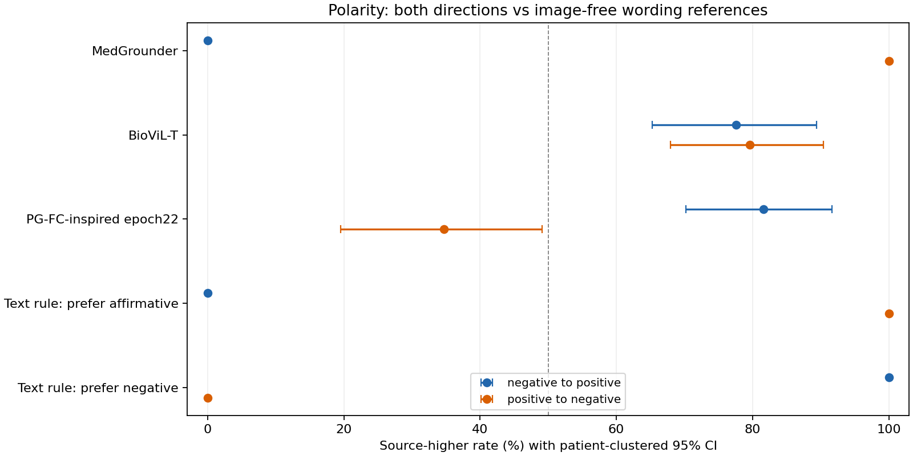

# Results and evidence map

## Frozen numerical tables

| File | Contents |
| --- | --- |
| [track1_spatial.csv](../results/track1_spatial.csv) | Spatial following, adherence, other/mixed, invalid and applicable abstention; direction and original-success breakdowns |
| [track1_nonspatial.csv](../results/track1_nonspatial.csv) | Native box rates and source-region retention for polarity and finding substitution |
| [biovilt_spatial_heatmap.csv](../results/biovilt_spatial_heatmap.csv) | Spatial peak-independent heatmap changes and confidence intervals |
| [biovilt_nonspatial_heatmap.csv](../results/biovilt_nonspatial_heatmap.csv) | Polarity and substitution heatmap response changes |
| [biovilt_nonspatial_localisation.csv](../results/biovilt_nonspatial_localisation.csv) | Five-model source region hit and retention, with BioViL-T peak results |
| [track2_scores.csv](../results/track2_scores.csv) | Strict paired preference, ties, score deltas, AUROC and confidence intervals |
| [track2_polarity_macro.csv](../results/track2_polarity_macro.csv) | Directional and macro polarity rates, including wording-only references |
| [joint_spatial_score.csv](../results/joint_spatial_score.csv) | Cross-tabulation of spatial outcomes and score responses |
| [pgfc_fixed_e.csv](../results/pgfc_fixed_e.csv) | Fixed E=0.5 decisions and accepted corrupted following |
| [pgfc_zero_box.csv](../results/pgfc_zero_box.csv) | Native and derived no-box rates, sliced by direction and variant |
| [pgfc_zero_box_sensitivity.csv](../results/pgfc_zero_box_sensitivity.csv) | Descriptive changes at alternative cutoffs; not used to retune the published cutoff |

[Joint spatial and score outcomes figure](../figures/grounding_score_joint.png)

## How to read the evidence

Following is a condition on the final spatial output, not evidence of movement from a correctly localised starting point. The original-success analysis restricts to correct source hits to examine that distinction. Laterality evidence is stronger and more uniform than vertical evidence. BioViL-T's lower peak-following rate does not establish better evidence retention: about a third of spatial pairs are other/mixed, and peak classifications depend on smoothing. The continuous heatmap measurements show both relative shift towards the corrupted zone and attenuation in the source region.

The polarity ranking directions differ sharply for MedGrounder and PG-FC-inspired. The wording-only baselines demonstrate why a single direction is inadequate. BioViL-T performs well on both directions but an image-only causal explanation was not tested. The PG-FC zero-box supplement decodes all negative polarity outputs as empty regardless of veracity; this is neither native abstention nor a repair of the verification head.

These findings do not establish clinical error detection, a statistically tested ranking across models, or that the models ignore images. The test set is a controlled, annotation-based proxy for naturally generated report errors. No systematic image-swap control was run on the final benchmark. Some directions and conditional populations are small, and the final PG-FC checkpoint adoption was benchmark-exposed. The repository keeps model scores, native output behaviour, and supplementary decoding separate.
